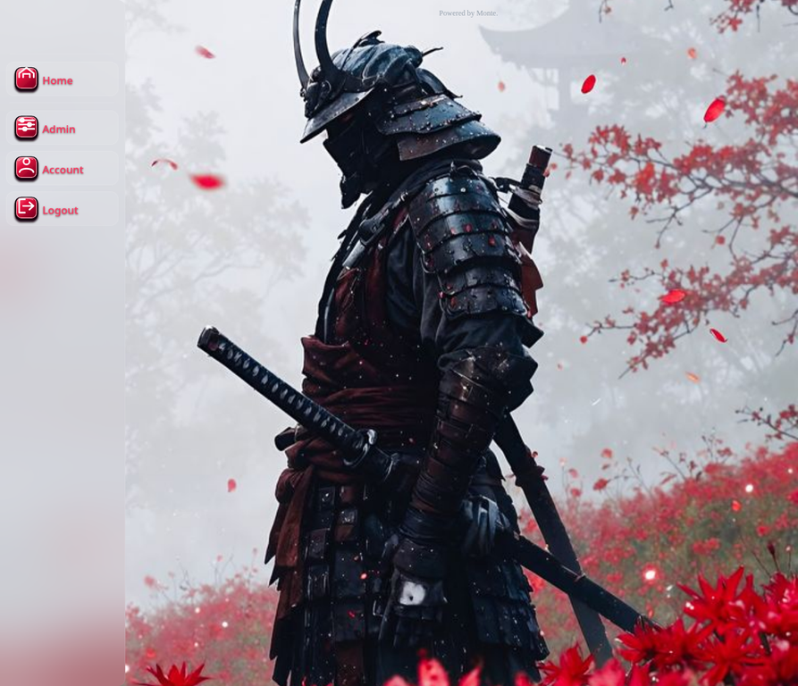
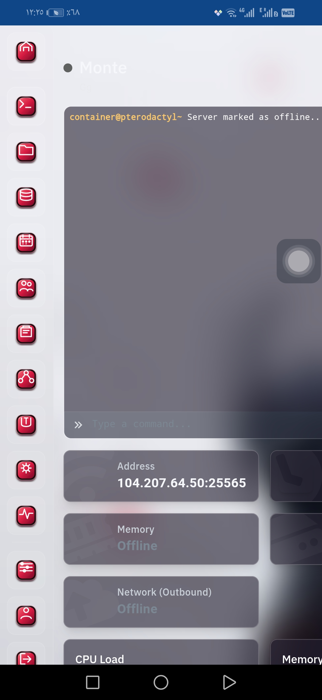

# Monte Pterodactyl Theme

**Powered by Monte**

A polished Monte-branded visual layer for Pterodactyl panels, built on top of the Nebula Blueprint extension. It adds a clear samurai background, glass-style panels, translucent dashboard surfaces, a wide labelled sidebar, custom red 3D SVG icons, and Monte branding.

> **License note:** This repository is private by default. The package contains a Nebula Blueprint bundle supplied for this deployment. Do not publish or redistribute Nebula materials unless you have the required permission and license rights.

## Preview

### Monte panel



### Design reference



## Requirements

- Ubuntu/Debian server with a working Pterodactyl panel.
- Root access to the server.
- Blueprint installed and available as the `blueprint` command.
- A supported Nebula Blueprint extension release.
- MySQL/MariaDB credentials available in `/var/www/pterodactyl/.env`.

The installer updates the bundled Nebula extension when Blueprint is already installed. It does not silently overwrite an unknown panel directory: use `PANEL_DIR=/your/panel/path` when the panel is not in the default location.

## Installation

This repository is private. Authenticate the VPS with GitHub first using a deploy key, GitHub CLI, or another approved repository credential. A plain unauthenticated `git clone` will be rejected by GitHub. For GitHub CLI:

```bash
gh auth login
gh repo clone mzml-gg/monte-pterodactyl-theme
cd monte-pterodactyl-theme
sudo PANEL_DIR=/var/www/pterodactyl ./install.sh
```

If the repository is already available on the server, run the installer directly:

The installer will:

1. Back up the current Nebula files and the `settings` table under `/root/monte-theme-backup-TIMESTAMP/`.
2. Install or update the bundled Nebula Blueprint extension with `blueprint -i nebula.blueprint`.
3. Install the Monte logo, samurai wallpaper, and custom 3D SVG icons.
4. Apply the glass sidebar, labelled navigation, translucent dashboard, background, and Monte branding settings.
5. Clear Laravel view/cache files and repair runtime ownership.

## Uninstall / rollback

The installer prints the backup directory. To restore the database settings:

```bash
mysql -u YOUR_DB_USER -p YOUR_DB_NAME < /root/monte-theme-backup-TIMESTAMP/settings.sql
```

Restore the previous files from `nebula-files.tgz` only after reviewing its contents:

```bash
tar -tzf /root/monte-theme-backup-TIMESTAMP/nebula-files.tgz
```

## Validation

After installation, verify the panel, services, and static assets:

```bash
for service in docker wings nginx php8.3-fpm redis-server mysql; do
  printf "%-12s " "$service"
  systemctl is-active --quiet "$service" && echo "200 ✅" || echo "DOWN ❌"
done

for url in \
  https://YOUR-PANEL-DOMAIN/ \
  https://YOUR-PANEL-DOMAIN/nebula-assets/monte-logo.jpg \
  https://YOUR-PANEL-DOMAIN/nebula-assets/samurai.jpg \
  https://YOUR-PANEL-DOMAIN/nebula-assets/icons3d/home.svg; do
  curl -fsSI "$url" | head -n 1
done
```

The installer invokes Blueprint with the bundle copied into the panel directory and removes Nebula's informational prompts automatically. A temporary `.monte-nebula-*.blueprint` file is removed when installation finishes.

This release was tested on an Ubuntu 24.04 Pterodactyl panel with Blueprint `beta-2026-08`, Docker 29.8.2, and Wings 1.13.3. The panel returned HTTP 200, all six services were active, and the Monte logo, background, and SVG icon assets returned HTTP 200.

Blueprint may print two non-fatal compatibility notices during the Nebula update: the supplied Nebula bundle targets a newer Blueprint build (`beta-A428-2`) and contains deprecated legacy extension flags. The installation completed successfully on Blueprint `beta-2026-08`; the panel and all Monte assets were verified with HTTP 200.

After installation, verify the panel and static assets:

```bash
curl -I https://YOUR-PANEL-DOMAIN/
curl -I https://YOUR-PANEL-DOMAIN/nebula-assets/monte-logo.jpg
curl -I https://YOUR-PANEL-DOMAIN/nebula-assets/icons3d/home.svg
```

Then hard-refresh the browser with `Ctrl+F5`. The footer should read **Powered by Monte** and link to [profile.monte-dev.online](https://profile.monte-dev.online).

## Repository

GitHub: [mzml-gg/monte-pterodactyl-theme](https://github.com/mzml-gg/monte-pterodactyl-theme)

**Powered by Monte.**
